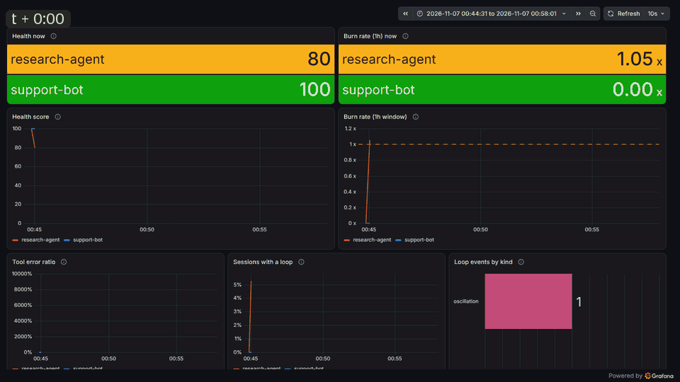
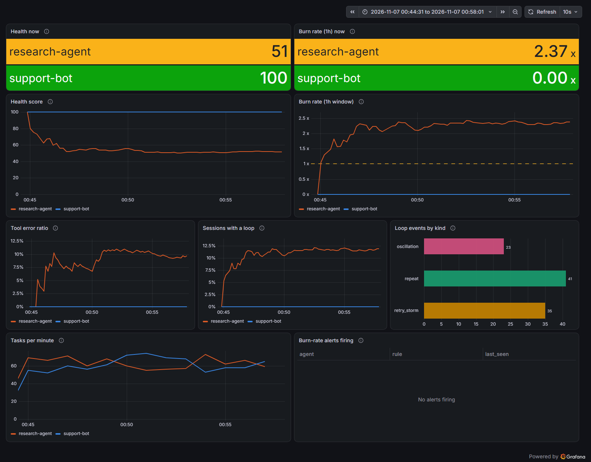
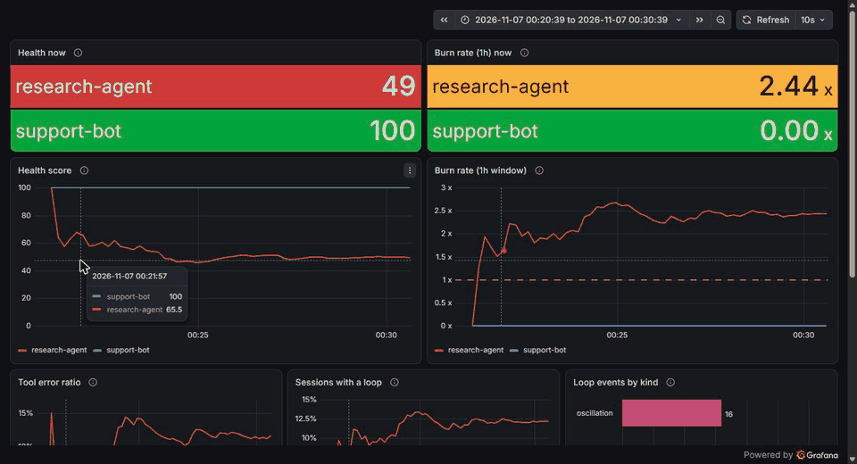

# agentslo

**SRE-style reliability for AI agents, as an OpenTelemetry Collector connector.**

LLM observability tools are good at answering "why did this trace do that?".
They are less good at answering the on-call question: *is this agent burning
its error budget right now, and should someone get paged?*

agentslo reads standard [OTel GenAI spans](https://opentelemetry.io/docs/specs/semconv/gen-ai/)
in the collector and turns them into reliability signals:

| Signal | What it catches |
|---|---|
| `agentslo.burn_rate{window=1h\|6h}` | Error-budget burn on agent *tasks* (`invoke_agent` spans), not individual LLM calls |
| `agentslo.alert.firing{rule=page\|ticket}` | Multi-window, multi-burn-rate alerts (Google SRE workbook) |
| `agentslo.loop.events{kind}` | `repeat` (same tool + args), `retry_storm` (same tool failing), `oscillation` (A,B,A,B…) |
| `agentslo.tool.error_ratio` | Failed tool calls / tool calls |
| `agentslo.health` | One 0–100 score per agent, weighted toward budget burn |

A task that *succeeds* after grinding the same tool call eight times still
counts as bad. That's the point: those are the runs that quietly cost money
and frustrate users while every error-rate dashboard stays green.

## Why a connector

- **Framework-agnostic.** Works with anything that emits GenAI semconv spans:
  no SDK, no decorators, no code changes in the agent.
- **Backend-agnostic.** Emits plain OTel metrics. ClickHouse is the demo;
  Prometheus, Elastic or any vendor works the same.
- **Privacy-preserving.** The connector only keeps a fingerprint of tool
  arguments (truncated SHA-256) for loop detection. Raw spans going to your
  backend are a separate path: the demo config hashes
  `gen_ai.tool.call.arguments` with the attributes processor before any
  exporter sees them, and you should do the same.

```
traces:  otlp ──► agentslo ──► (metrics pipeline) ──► clickhouse
              └─► clickhouse (raw spans)
```

## Run the demo

```bash
cd deploy
docker compose up --build
# Grafana:    http://localhost:3000  (dashboard opens on the home page)
# ClickHouse: http://localhost:8123  (database `otel`)
```

`examples/fakeagent` emits two agents: `support-bot` (healthy) and
`research-agent` (occasionally loops, retry-storms, oscillates, runs slow).
Set `SCENARIO=loop|retry_storm|oscillation|slow|healthy` to force one pattern.

## What it looks like



*Thirteen minutes from a cold start, one frame every 15 seconds.*

Both agents handle the same load, about 60 tasks a minute each. Neither is
"down". A dashboard of tool-call errors would show research-agent at
roughly 10% failed calls, the kind of number that gets a shrug.

The task-level view tells a different story. About one research-agent
session in eight trips a loop detector. Some of those runs (the repeat and
oscillation ones) even end with a *successful* `invoke_agent` span, but
they still count against the error budget. research-agent settles at
about 2.4x burn, on pace to spend a 30-day budget in under two weeks.
Its health drops to ~50; support-bot holds at 100.



No alert fires, and that's deliberate. The default rules page at 14.4x
(over both 1h and 5m) and open a ticket at 6x (over 6h and 30m). 2.4x is a
trend to fix this sprint, not a reason to wake anyone up.

"Loop events by kind" says where to look first. `repeat` leads: the agent
re-issuing the identical call, which is a prompt or planning problem.
`retry_storm` is close behind (one tool failing over and over, whatever the
arguments), which points at the tool itself. Two different fixes, and the
error rate alone wouldn't tell you either.

Hover any chart for exact values. The crosshair is shared, so every panel
lines up on the same moment:



The dashboard is provisioned from `deploy/grafana/` and queries ClickHouse
directly, so it doubles as a reference for querying the metrics yourself.

## Configuration

```yaml
connectors:
  agentslo:
    objective: 0.99        # SLO on agent tasks
    latency_target: 30s    # tasks slower than this are bad (0 = off)
    emit_interval: 15s
    ratio_window: 1h       # rolling window for tool-error and loop ratios
    loop:
      window: 10           # last N tool calls per session
      threshold: 4         # occurrences that trip a pattern
      idle_ttl: 30m
```

## Layout

- `internal/detect` – the engine (loops, burn rates, health). Stdlib only, fully unit-tested.
- `connector/agentsloconnector` – collector wiring: pdata → engine → metrics.
- `deploy/` – ocb build, collector config, docker-compose with ClickHouse and a provisioned Grafana dashboard.
- `examples/fakeagent` – span generator with known failure patterns.

## Status

Early. v0 keeps state in memory per collector instance, so run it behind a
load-balancing exporter keyed by `gen_ai.conversation.id` when scaling out.

All signals are rolling-window values: burn rate over 1h and 6h, the
tool-error and loop-session ratios over `ratio_window`. Eviction only frees
memory; it never resets a number.
